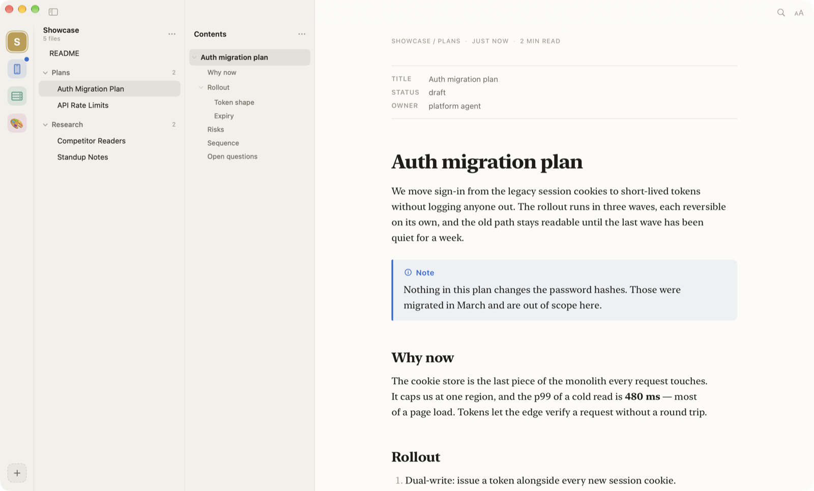

<p align="center">
  
</p>

<h1 align="center">Galley</h1>

<p align="center">
  A calm Mac reader for the Markdown your AI agents write.<br>
  <a href="https://github.com/aliemir/galley/releases/latest/download/Galley.dmg"><strong>Download for Mac</strong></a>
  · <a href="https://galley.aliemir.dev">Website</a>
  · macOS 15 or later · Free and open source
</p>



Agents write plans, specs and notes as Markdown, and rewrite them while you are
away. Galley is where you read them: point it at the folders your agents write
into, and every file reads like a typeset page.

- **See what changed.** What an agent changed since you last read a file is
  marked in the page itself — a bar in the margin, new words washed — not in a
  diff. Tick changes read one by one, or the whole file at once. New and
  changed files carry a dot, down to the Dock icon.
- **Mark it up, hand it back.** Highlight a passage, add a note, and save the
  round when it is ready — or copy it all as feedback for your agent, with
  the file and section of each passage.
- **Or let the agent read it.** The bundled `galley` command and its agent
  skill let Claude Code, Codex, Cursor and other agents read your feedback,
  act on it, and clear what they finished.
- **Made for reading.** Six typefaces, nineteen themes, continuous reading
  from one file into the next, a palette for files, sections, text and every
  action, and a shortcut for everything.
- **Paper, not an editor.** Galley never writes to your files and sends
  nothing anywhere — no account, no analytics, no network.

## Agents

Install the command and the skill from **Settings → Agents** (one click each),
then ask your agent to *address my feedback in Galley* — or to *keep watching
for my feedback*, and it picks up each round as you save it. Or use the
command yourself:

```sh
galley feedback plans/auth.md          # the saved highlights and notes on a file or folder
galley feedback . --json               # the same, as data
galley feedback . --wait               # wait for your next save, then print it
galley feedback . --watch              # print every save as it happens
galley feedback clear plans/auth.md    # clear them once they are dealt with
galley help                            # everything else
```

## Build it yourself

You need a Mac with Xcode, and macOS 15 or later to run the app. Swift
packages resolve on the first build; everything else is in the repo.

1. Clone the repo and open `app/Galley.xcodeproj`.
2. Select the **Galley** target → **Signing & Capabilities**, and pick your own
   team — or **Sign to Run Locally** if you have no Apple developer account.
   Change the bundle identifier too if you like; nothing else depends on it.
3. Build and run (⌘R), or from the terminal:

   ```sh
   xcodebuild -project app/Galley.xcodeproj -scheme Galley -destination 'platform=macOS' build
   ```

A build of your own keeps its library in `~/Library/Application Support/Galley`,
the same place as the released app, so run one or the other at a time.

### Signing a build for others

A build that other Macs open without a warning has to be signed with a
**Developer ID Application** certificate and notarized by Apple.
`tools/release.sh` does all of it — archive, sign, notarize and staple the app
and a drag-to-Applications DMG, then tag and publish a GitHub Release:

1. Create the certificate: Xcode → Settings → Accounts → your team →
   **Manage Certificates…** → **+** → **Developer ID Application**.
2. Create an App Store Connect API key (Users and Access → Integrations), put
   the `.p8` in `~/.appstoreconnect/private_keys/`, and fill in `.env` from
   `.env.example` — notarization signs in with that key.
3. Install and sign in to the GitHub CLI: `brew install gh`, `gh auth login`.

```sh
tools/release.sh 1.0.0 --local   # a signed DMG in build/release/, nothing published
tools/release.sh 1.0.0           # notarized, tagged and published on GitHub Releases
```

Release notes come from `notes/release-notes/<version>.md` when it exists.

## Repository

| Path | What |
|---|---|
| `app/` | The macOS app — SwiftUI and AppKit, with a WebKit page for the typesetting |
| `website/` | [galley.aliemir.dev](https://galley.aliemir.dev): landing, privacy and support pages |
| `tools/` | The release script, the guide's captures, debug drivers, the icon |
| `notes/` | The idea, decisions and changelog |

## Licence

MIT — see [LICENSE](LICENSE). Bundled third-party code and fonts keep their own
licences, listed in `app/Galley/Reader/Web/vendor/Acknowledgements.txt`.
