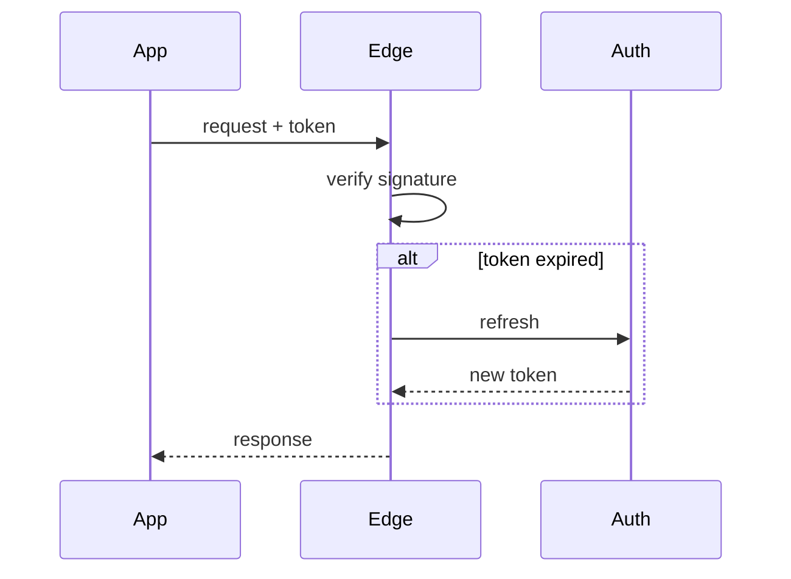

# Auth migration plan

We move sign-in from the legacy session cookies to short-lived tokens without
logging anyone out. The rollout runs in three waves, each reversible on its own,
and the old path stays readable until the last wave has been quiet for a week.

> [!NOTE]
> Nothing in this plan changes the password hashes. Those were migrated in
> March and are out of scope here.

## Why now

The cookie store is the last piece of the monolith every request touches. It
caps us at one region, and the p99 of a cold read is **480 ms** — most of a
page load. Tokens let the edge verify a request without a round trip.

## Rollout

1. Dual-write: issue a token alongside every new session cookie.
2. Dual-read: accept either, prefer the token, log which one was used.
3. Cut over: stop issuing cookies; expire the rest over 30 days.

- [x] Token format agreed with the security review
- [x] Signing keys in the vault, rotated monthly
- [ ] Dual-write behind the `auth.tokens` flag
- [ ] Dashboards for the cookie-to-token ratio

### Token shape

```swift
struct SessionToken: Codable {
    let subject: UUID
    let issuedAt: Date
    let expiresAt: Date
    let scopes: Set<Scope>

    var isExpired: Bool { expiresAt < .now }
}
```

### Expiry

A token lives for $t_{max} = 15$ minutes and refreshes in the background. The
chance a user meets a refresh failure in a session of $n$ requests is

$$
P(\text{failure}) = 1 - (1 - p)^{n}
$$

which stays under 0.1% for $p = 10^{-5}$ and any realistic $n$.[^budget]

## Risks

| Risk | Likelihood | Impact | Mitigation |
|:-----|:----------:|:------:|:-----------|
| Clock skew rejects valid tokens | Medium | High | 60 s leeway, NTP alarms |
| Refresh storm after an outage | Low | High | Jittered refresh, rate limits |
| Old mobile builds never upgrade | High | Low | Cookies stay readable for 90 days |

> [!WARNING]
> Do not shorten the cookie expiry before wave 3. Old iOS builds cache the
> cookie and would sign people out mid-session.

> [!tip]- Why not JWTs with long expiry?
> Revocation. A long-lived JWT cannot be taken back without a denylist, and a
> denylist is the session store we are trying to retire.

## Sequence



## Open questions

- Should service-to-service calls move in the same waves? See [[api-rate-limits|the rate limit note]].
- Who owns key rotation once the platform team hands this over? :thinking:
- ==Decide before wave 2:== keep the cookie domain or narrow it.

[^budget]: Assuming the 99.99% availability target for the auth service.
