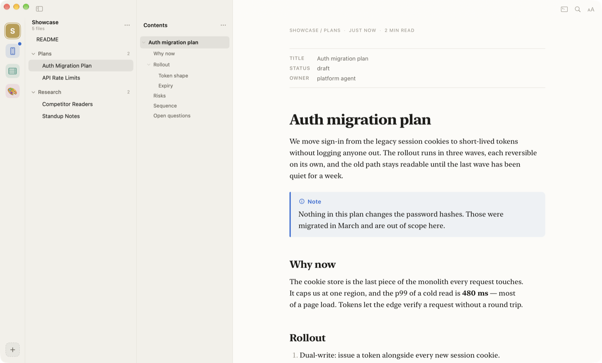
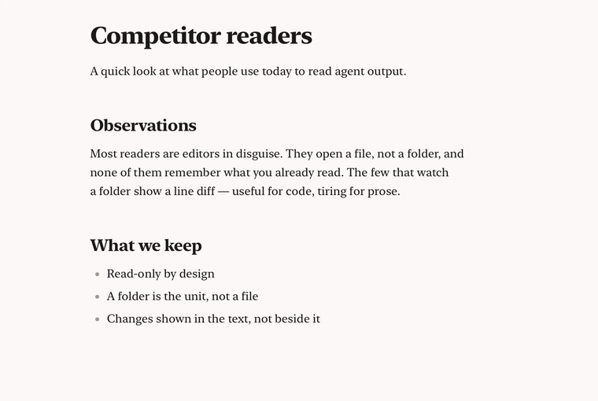
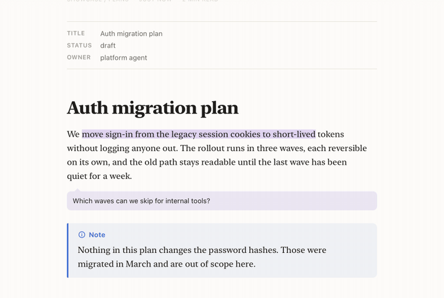
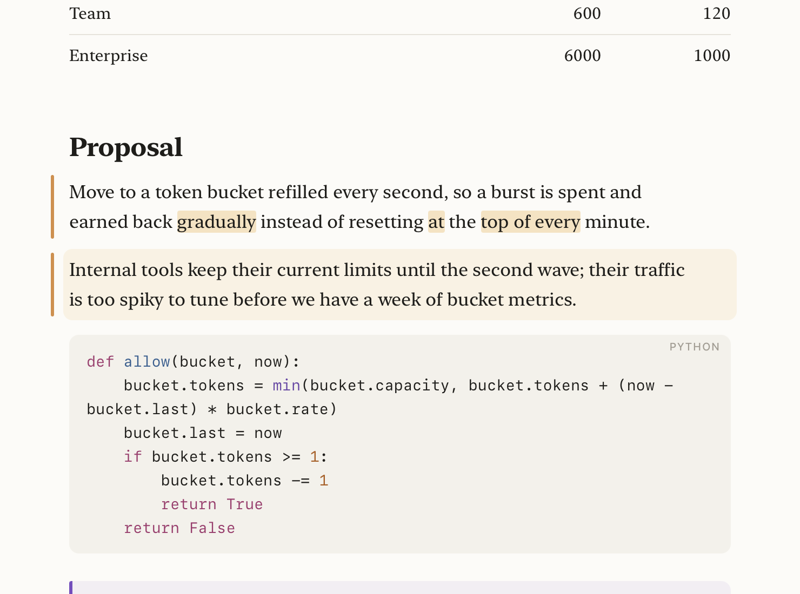
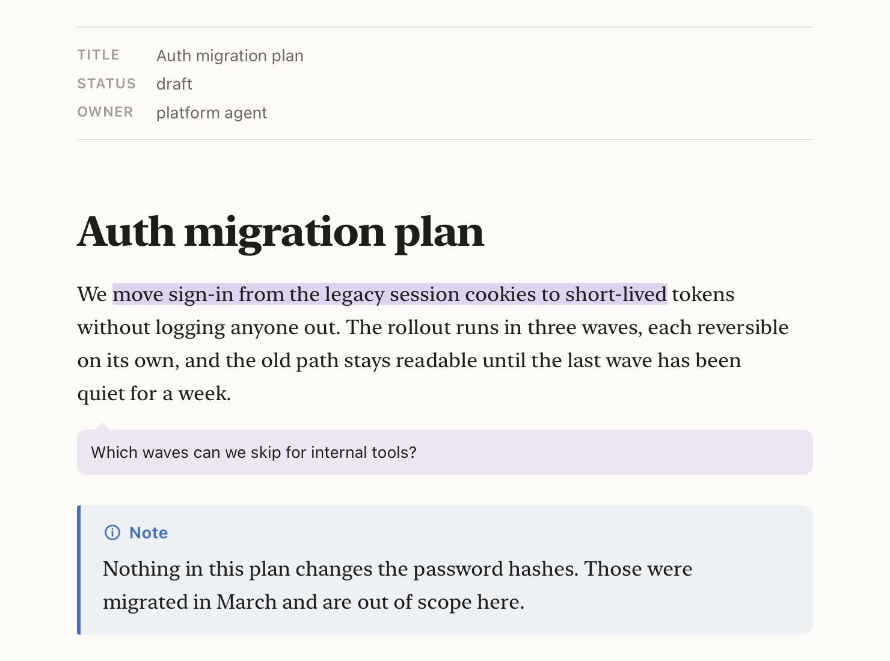
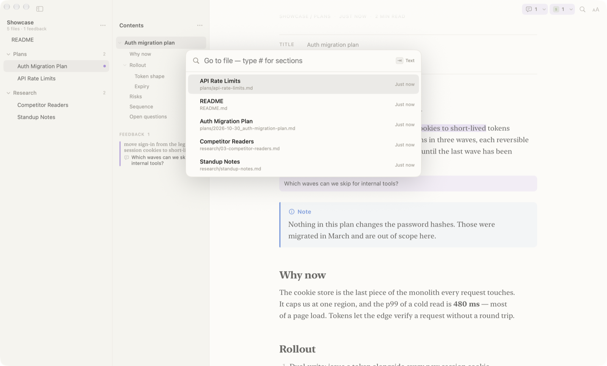
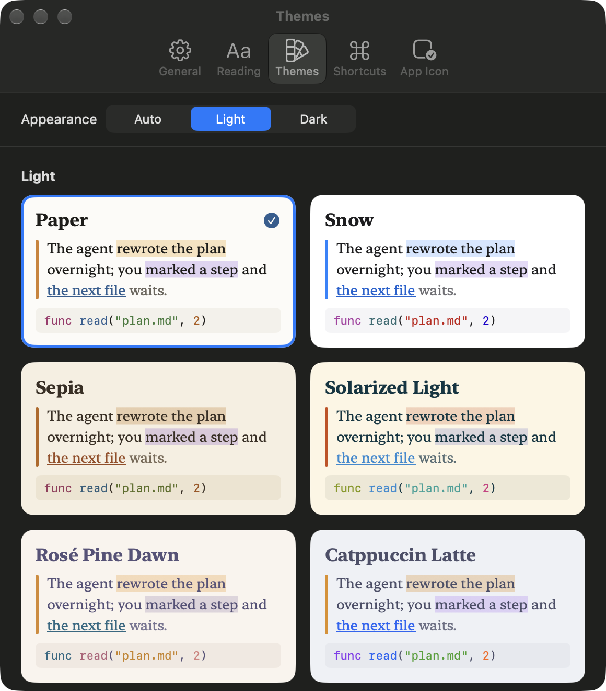
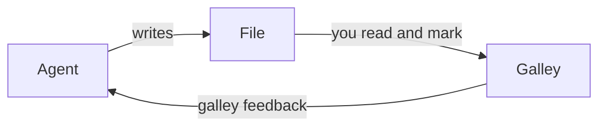

# Welcome to Galley

Galley is a reader for what your agents write. Point it at a folder, and
every Markdown file in it reads like a typeset page. When an agent changes
something you have already read, Galley marks the change. When you have
something to say, highlight it, add a note, and hand it back — or let the
agent come and read it.

It never changes your files. Everything you mark lives in Galley.



## Start with a folder

Press **⌘O**, or drop a folder on the window. The folder becomes a
*workspace*: Galley lists its Markdown files, watches them, and shows new
ones the moment they are written. Add as many workspaces as you like; they
sit in the rail on the left, each with an icon and colour you can change
(right-click → **Name and Icon…**).

A single file works too. Open it from Finder (**Open With → Galley**), drop it
on the window or the Dock icon, and it joins **Opened Files**.

## Read

Scroll as you would anywhere. At the end of a page, keep pulling: the next
file slides in. Pull past the top to go back. Galley remembers where you left
every file, and a file you have really looked at counts as read.



New files carry a blue dot, files changed since you read them an amber one —
in the file list, on the workspace, and as a number on the Dock icon.

## Columns

Workspaces, Files and Contents sit to the left of the page. Swipe right with
two fingers to bring them in, left to put them away — or **⌘1**, **⌘2** and
**⌘3** for each on its own, and **⌘\\** for all of them. The order swipes
follow is yours to set in **Settings → General**.



Drag a column's edge to resize it. Drag Workspaces narrow and it folds into a
rail of icons; drag it wide and the names come back.

## See what changed

Galley keeps a copy of each file as you last read it. When an agent rewrites
the file, the page shows what is new: added paragraphs get a bar in the
margin and a wash, edited ones show the words that came in. Removals stay
out of the way. **⌘J** jumps to the next change.



## Mark it up

Select a passage and choose **Highlight**, or **Note** to say something about
it. Your marks are purple everywhere, so they never look like the agent's
changes. Every highlight and note on a page is listed under **Feedback** in
the Contents column.



A passage the agent has since rewritten is shown as *likely addressed*.

## Hand it back

**Copy Feedback** (**⇧⌘C**, or the button at the top right) puts every
passage and note on the clipboard — with the file's path and the section each
passage sits in — ready to paste to your agent.

Or let the agent read it itself. Choose **Galley → Install Command Line Tool…**
and **Galley → Install Agent Skill** once; then tell your agent *"address my
feedback in Galley"*. It runs:

| Command | What it does |
|:--------|:-------------|
| `galley feedback plan.md` | Your highlights and notes on a file, or on every file under a folder |
| `galley feedback clear plan.md` | Clears them once the agent has dealt with them |
| `galley feedback clear docs --addressed` | Clears only the passages it rewrote |
| `galley plan.md` | Opens a file or folder in Galley |

The skill teaches the agent to work through every item, say what it did, and
clear only what it finished. `galley help` lists the rest.

## Find your way

**⌘K** goes to a file by name — type `#` for a section of this page.
**⇧⌘F** searches the text of every file. **⌘F** finds on this page.



**Tabs.** ⌘-click a file or a link, or press **⌘T**, to give it a tab of its
own. The tab bar only appears once there are two. **⌃Tab** steps through
them; a tab whose file an agent rewrote shows a dot.

## Hidden comments

HTML comments (`<!-- like this -->`) are invisible on a rendered page — but an
agent reading the file sees every word. Press **⇧⌘H** (View → Show Hidden Comments)
to show them faint and labelled.

<!-- This is a hidden comment. If you can read it, Show Hidden Comments is on. Press ⇧⌘H again to hide it. -->

There is one right above this line.

## Make it yours

Settings has nineteen themes, light and dark — Galley's own and the
well-known ones — six typefaces, and the size, spacing and width of the
text. Every shortcut can be changed in **Settings → Shortcuts**, and the
Dock icon comes in ten colours.



## Keys

| Keys | |
|:-----|:-|
| **⌘O** | Open a folder or file |
| **⌘K** / **⇧⌘K** | Go to a file / a section |
| **⇧⌘F** | Search every file |
| **⌘T** / **⌘W** | New tab / close tab |
| **⌃Tab** | Next tab |
| **⌥⌘↓** / **⌥⌘↑** | Next / previous file |
| **⌥⌘U** | Next unread file |
| **⌘J** / **⇧⌘J** | Next / previous change |
| **⌃⌘H** / **⌃⌘N** | Highlight / add a note to the selection |
| **⇧⌘C** | Copy feedback |
| **⌘1** **⌘2** **⌘3** / **⌘\\** | Workspaces, Files, Contents / all |
| **⇧⌘H** | Show hidden comments |
| **⌘+** / **⌘−** | Bigger / smaller text |

These are the defaults; **Settings → Shortcuts** has all of them.

## What a page can hold

Galley reads the Markdown agents actually write. This guide is one:

> [!TIP]
> Callouts in GitHub and Obsidian style, folded or open.

- [x] Task lists, tables and footnotes[^1]
- [x] Code with syntax colours, maths like $E = mc^2$, and ==marked text== :sparkles:
- [x] Front matter, wiki links, and the HTML agents use — <kbd>⌘</kbd> keys, folding:

<details>
<summary>Open me</summary>

Folded content, as agents write it for long logs.

</details>

```sh
galley feedback plans/ --json | jq '.[].items[].note'
```



[^1]: Like this one.

## Your files are safe

Galley only reads. It never writes to a Markdown file, keeps nothing outside
your Mac, and the page it draws cannot reach the network or run anything a
file brings with it: scripts, styles and frames in a file's HTML are removed.
A link to another Markdown file opens it in Galley; a link to a document — an
image, a PDF — opens it in its app; a link to an app or a script only shows
it in Finder.

---

This page stays in **Opened Files** until you remove it.
**Help → Galley Guide** opens it again.
