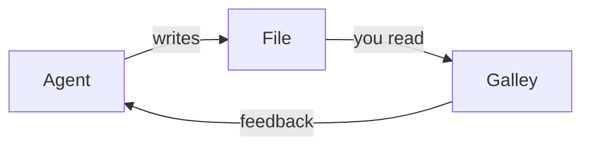

# Welcome to Galley

Galley is a reader for what your agents write. Point it at a folder, and
every Markdown file in it reads like a typeset page. When an agent changes
something you have already read, Galley marks the change. When you have
something to say, highlight it, add a note, and hand it back.

It never changes your files. Everything you mark lives in Galley.


## Start with a folder

Press **⌘O**, or drop a folder on the window. The folder becomes a
*workspace*: Galley lists its Markdown files, watches them, and shows new ones
the moment they are written. Add as many workspaces as you like; they sit in
the rail on the left.

A single file works too. Open it from Finder (**Open With → Galley**), drop it
on the window or the Dock icon, and it joins **Opened Files**.

## Read

Scroll as you would anywhere. At the end of a page, keep pulling: the next
file slides in. Pull past the top to go back. Galley remembers where you left
every file, and a file you have really looked at counts as read.

New files carry a blue dot, files changed since you read them an amber one —
in the file list, on the workspace, and as a number on the Dock icon.

## See what changed

Galley keeps a copy of each file as you last read it. When an agent rewrites
the file, the page shows what is new: added paragraphs get a bar in the
margin and a wash, edited ones show the words that came in. Removals stay
out of the way. **⌘J** jumps to the next change.


## Mark it up, hand it back

Select a passage and choose **Highlight**, or **Note** to say something about
it. Your marks are purple everywhere, so they never look like the agent's
changes. When you are done, **Copy Feedback** (⇧⌘C, or the button at the top
right) puts every passage and note on the clipboard, with the file's path,
ready to paste to your agent.


A passage the agent has since rewritten is shown as *likely addressed*, and
is left out the next time you copy.

## Find your way

| Keys | What it does |
|:-----|:-------------|
| **⌘K** | Go to a file by name — type `#` for a section of this page |
| **⇧⌘F** | Search the text of every file |
| **⌘F** | Find on this page |
| **⌘T** | Open a file in a new tab |
| **⌃Tab** | The next tab |
| **⌥⌘↓** / **⌥⌘↑** | The next or previous file |


⌘-click a file or a link to give it a tab of its own. The tab bar only
appears once there are two.

## Columns

Workspaces, Files and Contents sit to the left of the page. Swipe right with
two fingers to bring them in, left to put them away, or use **⌘1**, **⌘2**
and **⌘3** for each on its own and **⌘\\** for all of them. Drag a column's
edge to resize it; drag Workspaces narrow and it folds into a rail of icons.

## Make it yours

Settings has nineteen themes, light and dark — Galley's own and the
well-known ones — six typefaces, and the line spacing and width. Every
shortcut can be changed in **Settings → Shortcuts**, and the Dock icon comes
in ten colours.


## What a page can hold

Galley reads the Markdown agents actually write. This guide is one:

> [!TIP]
> Callouts in GitHub and Obsidian style, folded or open.

- [x] Task lists
- [x] Tables, code with syntax colours, and footnotes[^1]
- [x] Maths, like $E = mc^2$, and ==marked text== :sparkles:

```swift
let page = try await galley.read("plan.md")
```



[^1]: Like this one.

---

You can close this page at any time; it stays in **Opened Files** until you
remove it. **Help → Galley Guide** opens it again.
